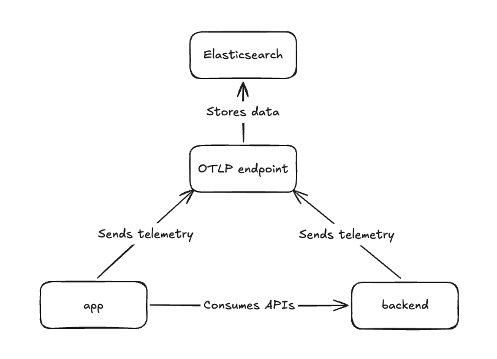

# EDOT React Native demo

This repository demonstrates the [Elastic Distribution of OpenTelemetry React
Native](https://github.com/elastic/elastic-otel-react-native) (EDOT React Native) in an end-to-end
weather application for Android and iOS. See the
[EDOT React Native documentation](https://github.com/elastic/elastic-otel-react-native/blob/main/docs/reference/edot-react-native/index.md)
for the full SDK reference.

Choose a city, request its current weather through a local instrumented backend, and inspect the
complete distributed trace in Elastic. The demo also includes focused examples of manual spans,
logs, tap events, an intentional backend error, and an intentional crash.

## Table of contents

- [What you can observe](#what-you-can-observe)
- [Components](#components)
  - [Backend service](#backend-service)
  - [React Native application](#react-native-application)
  - [Elastic Agent](#elastic-agent)
- [Prerequisites](#prerequisites)
- [Run the demo](#run-the-demo)
  - [1. Start the Elastic Stack](#1-start-the-elastic-stack)
  - [2. Start the instrumented backend](#2-start-the-instrumented-backend)
  - [3. Run the app](#3-run-the-app)
- [Inspect the data](#inspect-the-data)
- [Emulator, simulator, and physical-device networking](#emulator-simulator-and-physical-device-networking)
- [License](#license)

## What you can observe

- Distributed traces from a tap in the app through HTTP, the backend, and Open-Meteo.
- A `Creating app` span with an `Initialize React Native UI` child span and a correlated
  `During app creation` log.
- An ERROR log and a backend error when New York is selected.
- An `app.widget.click` event when you tap **Fetch forecast** or **Back**.
- A persisted crash report exported after the app is relaunched.

## Components



### Backend service

A simple Spring Boot service that provides APIs for the application and helps showcase the
distributed tracing use case. It is instrumented by the EDOT Java runtime attach library, and its
source is maintained in
[elastic/shared-otel-sdk-demo](https://github.com/elastic/shared-otel-sdk-demo/tree/main/backend).

### React Native application

The app's first screen has a city picker and a **Fetch forecast** button that takes you to the
second screen, where you'll see the selected city's current weather. If you pick New York, you'll
get an error from the local backend. This is to demonstrate how network and backend errors are
captured and correlated. The **Crash** button intentionally crashes the app so you can also inspect
crash reporting in Kibana.

EDOT starts in
[`MainApplication.kt`](android/app/src/main/java/com/reactnativedemoapp/MainApplication.kt) and
[`AppDelegate.swift`](ios/ReactNativeDemoApp/AppDelegate.swift) before React Native loads. Both
platforms read their settings from [`elastic-otel-config.json`](elastic-otel-config.json): the OTLP
endpoint, the service name `weather-demo-react-native`, and the resource attributes. The manual
spans and logs are in [`App.tsx`](App.tsx), and [`babel.config.js`](babel.config.js) turns on the
tap events.

### Elastic Agent

The [Elastic Agent](https://www.elastic.co/docs/reference/fleet/elastic-agent-as-otel-collector)
provides the OTLP endpoint that receives telemetry from the app and the backend service, then
forwards it to Elasticsearch for storage and analysis. In this demo, it is set up automatically as
part of [Step 1](#1-start-the-elastic-stack) via start-local.

## Prerequisites

- [Node.js](https://nodejs.org/) 22.11 or newer, with npm.
- [Docker](https://www.docker.com/).
- A checkout of
  [elastic/elastic-otel-react-native](https://github.com/elastic/elastic-otel-react-native) next to
  this repository, at `../elastic-otel-react-native`.
- For Android: JDK 21 and an
  [Android emulator](https://developer.android.com/studio/run/emulator#get-started) running API
  level 26 or newer.
- For iOS: macOS with Xcode, an iOS 16 or newer simulator, and
  [CocoaPods](https://cocoapods.org/).

## Run the demo

### 1. Start the Elastic Stack

Use [start-local](https://github.com/elastic/start-local/) to spin up Elasticsearch, Kibana, and the
Elastic Agent locally with a single command. In this setup, the Elastic Agent provides the OTLP
endpoint that receives telemetry from the app and the backend service. Run this command from the
repository root:

```sh
curl -fsSL https://elastic.co/start-local | sh -s -- --edot
```

This creates an `elastic-start-local` folder and starts all three services. Once it finishes, the
OTLP endpoint is available at `http://localhost:4318`.

You don't need to configure the OTLP endpoint for this demo application, as it has already been
set in [`elastic-otel-config.json`](elastic-otel-config.json).

You can stop and start the services later with the scripts in the `elastic-start-local` folder:

```sh
cd elastic-start-local
./stop.sh   # stop the services
./start.sh  # start them again
```

For more information on start-local, refer to the
[start-local documentation](https://github.com/elastic/start-local/).

### 2. Start the instrumented backend

The `backend-manager` script pulls the pre-built
[backend](https://github.com/elastic/shared-otel-sdk-demo/tree/main/backend) Docker image from
`ghcr.io` and runs it connected to the same network as the Elastic Agent.

Once the backend service is running, its endpoint is `http://localhost:8080/v1/`. You don't need to
set it for this demo application, as it has already been set in [`App.tsx`](App.tsx).

Run this command from the repository root:

```sh
./backend-manager start
```

To stop the backend:

```sh
./backend-manager stop
```

To stop the backend and remove the Docker image from your machine:

```sh
./backend-manager uninstall
```

### 3. Run the app

Install the EDOT React Native checkout from the sibling folder. Run this command from the
repository root:

```sh
npm install ../elastic-otel-react-native
```

To run the app on Android, start an emulator. The app sends telemetry to `localhost:4318`, so
forward that port from the emulator to your machine once, then build and launch a release build
of the app:

```sh
adb reverse tcp:4318 tcp:4318
npm run android -- --mode release
```

`adb reverse` lasts until the emulator restarts or adb reconnects. Run it again after either.

To run the app on iOS, boot a simulator. Set up the Xcode project and install its pods, then build
and launch a release build of the app:

```sh
npm run ios:install
npm run ios:run -- --mode Release
```

Once the app is running, select Berlin, London, or Paris and tap **Fetch forecast** to see the
city's current weather, then tap **Back**. Repeat it a few times to generate some load. To see the
intentional error path, select New York and tap **Fetch forecast**. The backend rejects that city
on purpose, which gives you an error trace to inspect and correlate with the app's request.

To demonstrate crash reporting, tap **Crash**. The app closes intentionally. Launch it again from
the emulator or simulator home screen: the crash report is exported on the next launch.

## Inspect the data

After launching the app and navigating through it, open Kibana at <http://localhost:5601> and log
in with username `elastic` and the password printed at the end of the start-local setup. You can
also find the password in `elastic-start-local/.env` (the `ES_LOCAL_PASSWORD` variable).

Useful service names:

- `weather-demo-react-native`
- `weather-demo-backend`

Useful span and log names:

- The `Creating app` and `Initialize React Native UI` spans.
- The `During app creation` log.
- The `app.widget.click` events with `app.widget.id` `fetch-forecast-button` or
  `forecast-back-button`.
- The `app.crash` event after the relaunch.

For a more detailed overview, take a look at how to Visualize telemetry in the docs for
[Android](https://www.elastic.co/docs/reference/opentelemetry/edot-sdks/android/getting-started#visualize-telemetry)
and
[iOS](https://www.elastic.co/docs/reference/opentelemetry/edot-sdks/ios/getting-started#visualize-telemetry).

## Emulator, simulator, and physical-device networking

On Android, the app sends telemetry to `localhost:4318`, which `adb reverse` forwards to your
machine, and reaches the backend through the emulator's
[`10.0.2.2`](https://developer.android.com/studio/run/emulator-networking#networkaddresses) host
alias. On iOS, the simulator reaches both services on `localhost`. A physical device cannot use
these addresses. To use one:

1. Change the OTLP export URL in [`elastic-otel-config.json`](elastic-otel-config.json) and the
   backend URL in [`App.tsx`](App.tsx) to your machine's LAN address.
2. Allow clear-text traffic to that address in the Android network security configuration and the
   iOS App Transport Security settings.
3. Ensure ports `4318` (Elastic Agent OTLP) and `8080` (backend) are reachable through your
   machine's firewall.
4. Keep the device and your machine on the same network.

The app permits clear-text traffic only to the local demo endpoints. Do not carry this local
clear-text configuration into a production application.

## License

Apache License 2.0. See [`LICENSE`](LICENSE).
